# Introduction

Resource estimates for fault-tolerant algorithms usually multiply a gate count by an assumed
logical error rate. This work runs the algorithms instead. A logical-level simulator (ftsim,
written for this project) executes the actual circuits, with every operation followed by its
measured logical channel and every waiting patch accumulating measured idle error. The results
are success probabilities as functions of code distance, physical error rate and magic-state
source, with error budgets that say which operations cause the failures.

The approach rests on one fact and one approximation. The fact: under Pauli circuit noise, for a
Clifford circuit decoded into a Pauli-frame correction, the logical action of one surface-code
operation is exactly a Pauli channel, since every syndrome history ends in some logical Pauli. The
approximation: consecutive operations' channels are composed as independent. Section 3.2
measures how good that is.

Contributions:

- A calibrated logical model of a rotated surface code under SD6 noise: idle (including logical Y),
  Z⊗Z and X⊗X merges and the surgery CNOT, from 316 experiments, with fits in d and p.
- A composition test: whole lattice-surgery experiments predicted from parts at the logical level
  and compared with circuit-level measurement.
- Shor's algorithm with honest arithmetic (no use of the period anywhere in the circuit) run on
  that model for N up to 143, scored by peak probability because, for small N, uniformly random
  outcomes already "factor" with probability 1.00 (N = 15); and the same with
  windowed arithmetic and measurement-based uncomputation.
- Phase estimation of molecular ground-state energies to chemical accuracy, from Hamiltonians computed
  from scratch (H₂, HeH⁺) and from a frozen-core CASSCF active space (LiH).
- Extrapolation to RSA-2048 and FeMoco, and a check of two published estimates' code distances against
  the measured model at their own failure budgets.

# Methods

## Circuit-level calibration

All physical-level simulation uses stabilizer-qec 1.2 (the author's engine, which matches Stim and
PyMatching) with SD6 noise at p ∈ {0.1, 0.2, 0.3, 0.5}% and correlated matching. Experiments: memories
of d, 2d, 3d and 4d rounds in both bases (d = 3 … 11), reference-qubit memories (d ≤ 7), Z⊗Z and X⊗X
merges of d rounds with d rounds apart before and after, the surgery CNOT (two merges and an ancilla
patch, 4d rounds in all), and, for the composition test, three Z⊗Z measurements in a row and a
three-patch merge. Each ran to 500 failures or a 300-second cap; every record keeps its seed.

**Channels through fidelities.** A distribution over flip patterns has Pauli fidelities
f(s) = Σₓ P(x)(−1)^(s·x), which multiply under composition. The per-round idle channel is the slope
of log f over the memory lengths (preparation and readout cancel). An operation's own channel is the
measured one divided by its baseline, where the baseline (preparation plus d rounds before, d rounds
plus readout after, each the square root of a 2d-round memory's fidelity) is first pushed through the
ideal operation: a CNOT copies an X error on the control onto the target and a Z on the target onto the
control, and an error before a merge changes its outcome. Dividing naively gives negative
probabilities for "X on the control only". Uncertainties are bootstrap (300 resamples).

**Logical Y.** X- and Z-basis memories see X∪Y and Z∪Y. A reference-qubit experiment gives the full
channel: the patch is projected noiselessly (every Z check by a noiseless Pauli-product measurement,
which round 1 is compared with), entangled with a perfect qubit by a noiseless Z_R Z_L measurement,
run, and ended by a perfect round and noiseless X_R X_L and Z_R Z_L measurements. Without the initial
projection an X error before the first Z-check readout flips Z_R Z_L unseen.

**Fits.** Each component ε(d, p) is fitted per p as log ε = a + b(d + 1)/2 by weighted least squares
over points with at least ten events, and globally as A(p/p*)^((d+1)/2). Values beyond the largest
measured distance are extrapolations and are marked as such in every figure.

## The machine

| operation | rounds | logical channel |
| :--- | ---: | :--- |
| X, Y, Z | 0 | none (Pauli frame) |
| H | 0 | none: transversal, orientation tracked in the fast block † |
| S, S† | d | Z⊗Z merge channel (|Y⟩ resource); wrong outcome → Z |
| T, T† | d | merge channel + Z w.p. ε_T † + wrong outcome → Z w.p. ½ (twirled S) |
| CX, CZ | 2d | measured surgery-CNOT channel, idling included |
| CCX, CCZ | 2d | 3 merges + Z-type w.p. ε_CCZ † + wrong outcomes → twirled CZ; d rounds idle |
| M, R | 1 | one round of idling |
| idle | per round | measured (p_X, p_Y, p_Z) |
| feed-forward | 10 | decoder reaction time before a TABLE † |

† marks cited inputs. Magic states: injection (ε_T = p, conservative against Li 2015's ≈ 0.4p), 15-to-1
distillation (Litinski 2019, Table 1: 4.5×10⁻⁸ per T and 5.2×10⁻¹¹ per CCZ at p = 0.1%) and cultivation
(Gidney, Shutty and Jones 2024: 2×10⁻⁹ at p = 0.1%, 4×10⁻¹¹ at 0.05%; |CCZ⟩ by 8T-to-CCZ, 28 ε_T²). Physical
qubits: Litinski's fast block, 2n + ⌈√(8n)⌉ + 1 tiles of 2(d + 1)² qubits, plus factories sized by their
published qubit·rounds per state. One round is 1 µs.

The noise compiler gives every qubit a clock. An operation starts when its qubits are free (a TABLE
also waits for its records plus the reaction time); each waiting qubit receives the composed idle
channel for its gap; the operation's channel follows it with a class label for attribution. REPEAT
blocks are barriers, scheduled once; TABLE cases are padded to the longest, so the schedule does not
depend on outcomes. Channel composition is written with log1p/expm1: per-round rates reach 10⁻²⁰ at
large d and a naive 1 − (1 − 2q)ⁿ cancels to zero.

## The simulator

ftsim (Rust) runs programs in a Stim-like format: Clifford + T + Toffoli gates, Pauli channels on
one to three qubits, measurements, REPEAT, and TABLE (classical feed-forward choosing a block by
earlier records). Backends: a sparse state (hash map of basis states; runs of permutation and phase
gates fused per basis state), which handles 36-qubit Shor circuits in milliseconds per shot, and a
dense vector. Each shot's RNG derives from (seed, shot), so results do not depend on threads.

**Stratified sampling.** With K the number of static faults, P(success) = Σₖ P(K = k)·Sₖ. P(K = k) is
computed exactly (a truncated generating polynomial over the site tree, REPEAT by exponentiation), and Sₖ
is estimated from shots with exactly k faults, drawn by sampling k sites with weights q/(1 − q) and
rejecting duplicates, which is exactly the conditional law. Strata beyond the tail cutoff carry their
mass as an interval. The one-fault stratum, with faults logged, gives each operation class's harm.

## Algorithms

**Textbook Shor.** Cuccaro ripple-carry adders; modular addition of a classical constant with a sign flag
(Vedral–Barenco–Ekert, Beauregard); controlled modular multiplication with uncomputation by the inverse
and a controlled swap; 3n + 6 qubits and 2n(2n(10n + 12) + n) Toffolis. One control qubit is recycled
through 2n rounds of a semiclassical approximate QFT whose correction rotations, chosen by TABLE from
the previous ⌈log₂ 2n⌉ + 2 records, are synthesized by gridsynth to ε = 10⁻³/2n and verified as matrices.
The base is a = 2 for every N. Every multiplier is the generic circuit, even when its constant is 1.

**Windowed Shor with measurement-based uncomputation.** The adder computes each carry with a Toffoli
into a fresh qubit and, instead of uncomputing it with a second Toffoli, measures it in the X basis
and applies CZ to the carry's two inputs when the outcome is 1 (Gidney 2018), a TABLE in the program;
subtraction is addition under bitwise complement. The exponent is read two bits at a time: for each
window the multiple a^(2^j·m) mod N (m ∈ {1, 2, 3}) is looked up into an (n + 1)-qubit register and
added under modular reduction, halving the number of controlled multiplications. The circuit has
4n + 7 qubits; its Toffoli count is a closed form equal to the compiled circuits' for every simulated N.

**Chemistry.** STO-3G integrals of s Gaussians in closed form (Boys F₀), restricted Hartree–Fock with
DIIS, Jordan–Wigner with interleaved spins, and Z₂ tapering of both spin parities (Bravyi et al.).
Iterative phase estimation reads 10 bits of U = exp(−i(H − E_HF)τ) with τ = 2π, approximated by four
fourth-order Suzuki steps; controlled Pauli rotations use only uncontrolled synthesized Rz's, so their
global phases stay global.

**LiH active space.** LiH in STO-3G has six spatial orbitals. Integrals come from PySCF; the Li 1s² core
is frozen into an effective one-body term, h_pq + Σ_c [2(pq|cc) − (pc|cq)], and the two valence electrons
are placed in two orbitals optimised by CASSCF(2, 2), which after tapering leaves a 2-qubit, 9-term
Hamiltonian. Its ground energy equals PySCF's CASSCF energy to 10⁻⁹ Ha. It is a deliberately small
problem: its value here is a third molecule through the same pipeline, not chemical scale.

# Results

## The calibrated machine

316 experiments, 0.82×10⁹ shots and 459,686 logical failures. Suppression
factors Λ (per two units of distance):

| p | idle (X∪Y) | idle (Z∪Y) | CNOT X on target | CNOT Z on control | Z⊗Z patch Z | Z⊗Z wrong outcome |
| :--- | ---: | ---: | ---: | ---: | ---: | ---: |
| 0.1% | 10.93 | 10.06 | 7.91 | 7.10 | 7.12 | 12.30 |
| 0.2% | 4.86 | 4.72 | 3.42 | 3.43 | 3.17 | 6.33 |
| 0.3% | 2.80 | 2.85 | 2.01 | 2.01 | 1.98 | 2.97 |
| 0.5% | 1.55 | 1.62 | 1.13 | 1.11 | 1.11 | 1.58 |

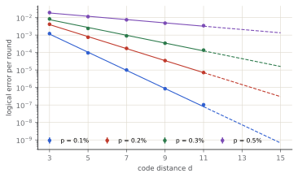

At p = 0.1% an idle patch errs 8.8×10^-7^ per round at d = 9 (X∪Y), and the fit gives 4.3×10^-15^
at d = 25 for X∪Y alone (1.3×10^-14^ for any Pauli; Section 3.8). Logical Y is 4% of the X∪Y rate at d = 3, 43× what
independent X and Z would give: Y errors are included as measured.

**Cross-check.** 36 experiments rerun with Stim and PyMatching (correlated) agree with
stabilizer-qec within statistics (largest |z| = 2.2).

## Composition

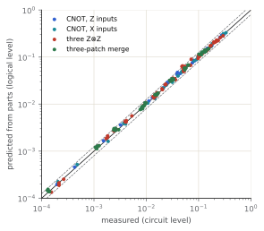

Across 48 experiment–noise–distance combinations the predicted failure rate is
0.93–1.26× the measured one, median 1.04×. The independent-composition
model is accurate to about 10% and leans pessimistic.

## Shor's algorithm

At p = 0.1% with cultivated magic states:

| N | n | logical qubits | Toffolis | T | noiseless peak | random peak | random factors | d for 90% | physical qubits | run time |
| :--- | ---: | ---: | ---: | ---: | ---: | ---: | ---: | ---: | ---: | ---: |
| 15 | 4 | 18 | 3,360 | 223 | 1.000 | 0.0156 | 0.996 | 13 | 55.4 k | 225 ms |
| 21 | 5 | 21 | 6,250 | 317 | 0.790 | 0.0059 | 0.999 | 13 | 58.1 k | 418 ms |
| 35 | 6 | 24 | 10,440 | 425 | 0.790 | 0.0029 | 1.000 | 15 | 63.4 k | 808 ms |
| 77 | 7 | 27 | 16,170 | 519 | 0.774 | 0.0018 | 1.000 | 15 | 67 k | 1.25 s |
| 143 | 8 | 30 | 23,680 | 635 | 0.774 | 0.0009 | 1.000 | 15 | 70.8 k | 1.81 s |

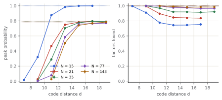

Factoring success is a poor score for small N. Classical post-processing that tries the
convergents' small multiples finds the factors from most outcomes, and the noisiest runs look best.
The peak probability falls to its random baseline (r/2^m) instead.

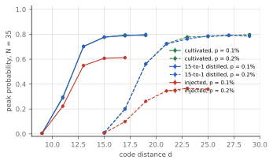

| magic states | p | ε_T † | ε_CCZ † | best peak | d for 90% |
| :--- | ---: | ---: | ---: | ---: | ---: |
| cultivated | 0.1% | 2.0×10^-9^ | 1.1×10^-16^ | 0.794 (d = 17) | 15 |
| cultivated | 0.2% | 1.0×10^-7^ | 2.8×10^-13^ | 0.798 (d = 29) | 21 |
| 15-to-1 distilled | 0.1% | 4.5×10^-8^ | 5.2×10^-11^ | 0.799 (d = 19) | 15 |
| 15-to-1 distilled | 0.2% | 3.6×10^-7^ | 3.3×10^-9^ | 0.793 (d = 27) | 21 |
| injected | 0.1% | 1.0×10^-3^ | 2.8×10^-5^ | 0.612 (d = 17) | never |
| injected | 0.2% | 2.0×10^-3^ | 1.1×10^-4^ | 0.366 (d = 23) | never |

**Error budget** (N = 35, d = 15, cultivated, p = 0.1%):

| class | expected faults | share | score of one-fault runs |
| :--- | ---: | ---: | ---: |
| idle | 0.027 | 80.3% | 0.394 |
| CNOT | 5.3×10^-3^ | 15.9% | 0.564 |
| CCZ | 1.2×10^-3^ | 3.7% | 0.667 |
| T | 1.7×10^-5^ | 0.0% | — |
| S | 1.0×10^-5^ | 0.0% | — |
| measure | 3.7×10^-8^ | 0.0% | — |

Idling accounts for 80% of the expected faults. The textbook circuit runs one Toffoli at a
time (the schedule averages 5.13·d rounds per Toffoli with 3.2 patches busy)
while every other patch waits. The last column is the peak probability of runs with exactly one fault
of that class: a single logical fault is far from always fatal.

## Windowed arithmetic

| N | arithmetic | logical qubits | Toffolis | rounds (d=11) | peak (d=11) | d for 90% | physical qubits | run time |
| :--- | ---: | ---: | ---: | ---: | ---: | ---: | ---: | ---: |
| 15 | textbook (Cuccaro) | 18 | 3,360 | 189,969 | 0.874 | 13 | 55.4 k | 225 ms |
| 15 | windowed (k = 2, MBU) | 23 | 1,248 | 107,387 | 0.913 | 11 | 46.1 k | 107 ms |
| 21 | textbook (Cuccaro) | 21 | 6,250 | 353,564 | 0.467 | 13 | 58.1 k | 418 ms |
| 21 | windowed (k = 2, MBU) | 27 | 2,390 | 254,313 | 0.506 | 13 | 47 k | 298 ms |
| 35 | textbook (Cuccaro) | 24 | 10,440 | 592,744 | 0.288 | 15 | 63.4 k | 808 ms |
| 35 | windowed (k = 2, MBU) | 31 | 3,528 | 381,614 | 0.343 | 13 | 50.2 k | 447 ms |

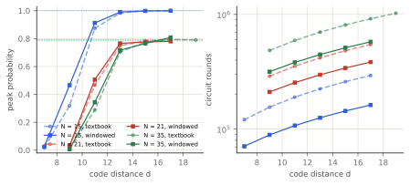

On N = 15, 21, 35 the windowed circuit uses 2.6–3.0× fewer
Toffolis and 1.4–1.8× fewer rounds at d = 11, for
5–7 more logical qubits. Rounds fall less than
Toffolis because each measurement-based uncomputation waits for the decoder before its CZ correction.
Shorter runs idle less: the distance for 90% of the noiseless peak is
N = 15: 13 → 11; N = 21: 13 → 13; N = 35: 15 → 13.

## Phase estimation

| molecule | logical qubits | terms | T gates | E_HF (Ha) | E_FCI (Ha) | noiseless | best | d for 90% | run time | physical qubits |
| :--- | ---: | ---: | ---: | ---: | ---: | ---: | ---: | ---: | ---: | ---: |
| H2 | 3 | 5 | 1.8×10^7^ | -1.116714 | -1.137276 | 0.92 | 0.91 (d = 23) | 19 | 7.2 min | 22.1 k |
| HeH+ | 3 | 9 | 4.4×10^7^ | -2.841836 | -2.851466 | 0.97 | 0.91 (d = 23) | 21 | 20.3 min | 22.4 k |

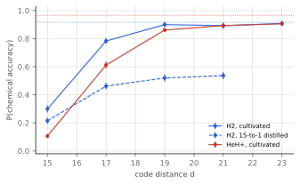

Each run uses ≈ 1.8×10^7^ T gates for H₂, so the magic-state error sets a floor
that no distance removes. With cultivated states (2×10⁻⁹) that floor is a few percent; with 15-to-1
distilled states (4.5×10⁻⁸) most runs fail.

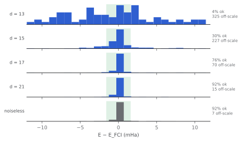


## LiH

| R (Å) | E_RHF (Ha) | E_CASCI (Ha) | E_CASSCF (Ha) | E_FCI (Ha) | Δ(CASSCF − FCI) (mHa) |
| :--- | ---: | ---: | ---: | ---: | ---: |
| 1.000 | -7.767362 | -7.767497 | -7.782355 | -7.784460 | +2.105 |
| 1.143 | -7.821772 | -7.821916 | -7.836724 | -7.838533 | +1.809 |
| 1.286 | -7.850149 | -7.850314 | -7.865659 | -7.867261 | +1.602 |
| 1.429 | -7.861861 | -7.862059 | -7.878610 | -7.880050 | +1.440 |
| 1.571 | -7.862662 | -7.862913 | -7.881364 | -7.882669 | +1.304 |
| 1.714 | -7.856258 | -7.856587 | -7.877654 | -7.878839 | +1.185 |
| 1.857 | -7.845114 | -7.845561 | -7.869990 | -7.871067 | +1.077 |
| 2.000 | -7.830906 | -7.831534 | -7.860107 | -7.861088 | +0.981 |
| 2.143 | -7.814787 | -7.815698 | -7.849237 | -7.850132 | +0.895 |
| 2.286 | -7.797564 | -7.798927 | -7.838270 | -7.839088 | +0.817 |
| 2.429 | -7.779811 | -7.781926 | -7.827858 | -7.828605 | +0.747 |
| 2.571 | -7.761957 | -7.765356 | -7.818461 | -7.819142 | +0.681 |
| 2.714 | -7.744336 | -7.749961 | -7.810364 | -7.810982 | +0.618 |
| 2.857 | -7.727221 | -7.736649 | -7.803674 | -7.804233 | +0.559 |
| 3.000 | -7.710830 | -7.726428 | -7.798338 | -7.798843 | +0.505 |

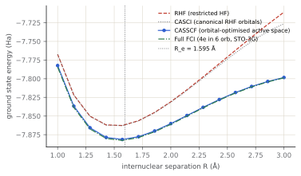

With the core frozen, CASSCF(2, 2) stays within 0.5–2.1 mHa of full STO-3G FCI along the
curve; CASCI on canonical RHF orbitals is 17–72 mHa above it, and RHF, which cannot
dissociate the bond correctly, is 88 mHa above it at R = 3.0 Å. At R = 1.595 Å the active space
recovers 19.1 of the 20.4 mHa correlation energy and lies
1.3 mHa above FCI, inside chemical accuracy but using most of it.

Phase estimation of the active-space Hamiltonian (4.3×10^7^ T gates per run; 400 shots per
configuration, at least 60 per fault stratum):

| distance | factory | noise p | chem. acc. (CASSCF) | chem. acc. (full FCI) | E[faults] | physical qubits | quantum time |
| :--- | ---: | ---: | ---: | ---: | ---: | ---: | ---: |
| d = 13 | cultivated | 0.1% | 3.0% ± 0.9% | 1.5% | 41.80 | 22.1 k | 12.4 min |
| d = 15 | cultivated | 0.1% | 10.8% ± 1.3% | 7.2% | 5.21 | 21.3 k | 14.3 min |
| d = 17 | cultivated | 0.1% | 57.7% ± 1.8% | 36.6% | 0.72 | 21.1 k | 16.2 min |
| d = 19 | cultivated | 0.1% | 76.5% ± 1.7% | 50.8% | 0.17 | 21.5 k | 18.1 min |
| d = 21 | cultivated | 0.1% | 79.4% ± 1.7% | 51.0% | 9.66e-02 | 22.4 k | 20 min |
| d = 23 | cultivated | 0.1% | 82.2% ± 1.6% | 52.8% | 8.78e-02 | 23.7 k | 21.9 min |
| d = 15 | 15-to-1 distilled | 0.1% | 10.0% ± 1.2% | 5.1% | 7.07 | 16.1 k | 14.3 min |
| d = 17 | 15-to-1 distilled | 0.1% | 25.4% ± 1.9% | 14.9% | 2.58 | 16.5 k | 16.2 min |
| d = 19 | 15-to-1 distilled | 0.1% | 28.5% ± 1.9% | 17.4% | 2.03 | 17.4 k | 18.1 min |
| d = 21 | 15-to-1 distilled | 0.1% | 28.1% ± 1.8% | 19.0% | 1.96 | 18.7 k | 20 min |

The noiseless circuit is within chemical accuracy of the active-space energy 88% of the
time. With cultivated states the best distance reaches 82% (d = 23);
with 15-to-1 distilled states the success saturates near 28%, the magic-state
floor of ≈ 2.0 expected faults per run.

## To scale

Operation counts of both RSA-2048 circuits are exact; the schedule structure is fitted on compiled
instances (rounds per Toffoli: 5.13 textbook vs. 8.54 windowed; patches busy:
3.18 vs. 2.79). The smallest odd d with at most 0.1 expected faults
(p = 0.1%, cultivated magic states):

| arithmetic | calibration | logical qubits | Toffolis | d | physical qubits | run time |
| :--- | :--- | ---: | ---: | ---: | ---: | ---: |
| textbook | separate measure and reset layers | 6,150 | 3.4×10^11^ | 35 | 32.5 M | 1.96 years |
| textbook | one measure-and-reset layer | 6,150 | 3.4×10^11^ | 33 | 29 M | 1.85 years |
| windowed + MBU | separate measure and reset layers | 8,199 | 8.6×10^10^ | 35 | 43.2 M | 298 days |
| windowed + MBU | one measure-and-reset layer | 8,199 | 8.6×10^10^ | 33 | 38.5 M | 281 days |

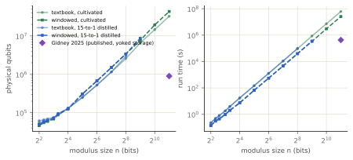

Windowed arithmetic shortens the RSA-2048 run from 1.96 years to 298 days but needs
more logical qubits, so it is not smaller. Both are far from Gidney's 2025 design, whose arithmetic,
layout and storage are different in kind; this section measures the error model, not that design.

**Published estimates.** For published algorithms the logical counts and run time come from the paper and
only the error model is ours. Each is compared at its authors' own failure budget and by distance only:
their physical-qubit totals depend on layouts (yoked storage, hand-made floor plans) not modelled here.
Gidney 2025 is taken one shot at a time (12.07 h, at most 1,409 logical qubits): his budget is per shot,
and a failed shot is repeated.

| workload | logical qubits | Toffolis | run time | failure budget | published d | d, as calibrated | d, one measure-and-reset layer |
| :--- | ---: | ---: | ---: | ---: | ---: | ---: | ---: |
| RSA-2048, Gidney 2025 (one shot) | 1,409 | 7.1×10^8^ | 12.1 h | 6.7% | 25 | 29 | 27 |
| FeMoco (THC), Lee et al. 2021 | 2,142 | 5.3×10^9^ | 2.45 days | 1.0% | 31 | 31 | 29 |

## Gidney 2025's distance under the measured model

Gidney chooses d = 25 because his projection of surface-code memory (the legend of his Figure 6:
p~L~ ≈ 3.5^−d^/40 per patch per round, from the yoked-surface-code simulations of Gidney, Newman, Brooks
and Jones) first reaches 10⁻¹⁵ per patch per round there; over a 12-hour shot of up to 1,600
logical qubits that leaves 93.3% of shots free of logical errors. Asked the same question, the measured
model answers d = 29 (d = 27–29 within the fit's 1σ band):

| d | measured model | 1σ band | 2σ band | Gidney's projection | ratio |
| :--- | ---: | ---: | ---: | ---: | ---: |
| 3 | 2.0×10^-3^ | 1.9×10^-3^ – 2.1×10^-3^ | 1.8×10^-3^ – 2.2×10^-3^ | 5.8×10^-4^ | 3.4× |
| 7 | 1.8×10^-5^ | 1.8×10^-5^ – 1.9×10^-5^ | 1.7×10^-5^ – 2.0×10^-5^ | 3.9×10^-6^ | 4.7× |
| 11 | 1.7×10^-7^ | 1.5×10^-7^ – 1.8×10^-7^ | 1.4×10^-7^ – 2.0×10^-7^ | 2.6×10^-8^ | 6.5× |
| 21 * | 1.4×10^-12^ | 1.1×10^-12^ – 1.7×10^-12^ | 9.0×10^-13^ – 2.2×10^-12^ | 9.4×10^-14^ | 14.8× |
| 23 * | 1.3×10^-13^ | 1.1×10^-13^ – 1.7×10^-13^ | 8.3×10^-14^ – 2.2×10^-13^ | 7.7×10^-15^ | 17.5× |
| 25 * | 1.3×10^-14^ | 1.0×10^-14^ – 1.7×10^-14^ | 7.7×10^-15^ – 2.2×10^-14^ | 6.3×10^-16^ | 20.8× |
| 27 * | 1.3×10^-15^ | 9.4×10^-16^ – 1.7×10^-15^ | 7.1×10^-16^ – 2.3×10^-15^ | 5.1×10^-17^ | 24.7× |
| 29 * | 1.2×10^-16^ | 9.0×10^-17^ – 1.7×10^-16^ | 6.6×10^-17^ – 2.3×10^-16^ | 4.2×10^-18^ | 29.4× |
| 31 * | 1.2×10^-17^ | 8.5×10^-18^ – 1.7×10^-17^ | 6.1×10^-18^ – 2.4×10^-17^ | 3.4×10^-19^ | 35.0× |

\* extrapolated beyond the measured distances (d ≤ 11). Bands are the weighted least-squares fits'
parameter covariance, both bases moved together.

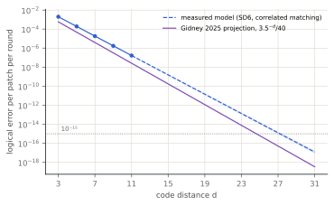

The gap is not only extrapolation. At the measured distances SD6 memories decoded by correlated matching
already fail 3.4–6.5× more often than the projection, and the fitted suppression per two
units of distance (Λ = 10.1 and 10.9 for the two bases) is below its
12.25, so the ratio grows to 21× at d = 25. The two
are fits to different simulations; Section 3.9 separates the circuit from the noise model.

Running one shot of his algorithm through the estimator of this report:

| varied | scenario | d | Δd |
| :--- | :--- | ---: | ---: |
| baseline | one shot at his budget (E[faults] ≤ 0.069) | 29 | 0 |
| Idle fit | rates at the −2σ edge of the fit | 27 | -2 |
| Idle fit | rates at the −1σ edge of the fit | 27 | -2 |
| Idle fit | rates at the +1σ edge of the fit | 29 | +0 |
| Idle fit | rates at the +2σ edge of the fit | 29 | +0 |
| Extrapolation | Λ × 1.15 beyond the measured distances | 27 | -2 |
| Magic states | ε_CCZ × 0.1 | 29 | +0 |
| Magic states | ε_CCZ × 10 | 29 | +0 |
| Budget | 90% of shots succeed (E[faults] ≤ 0.1) | 27 | -2 |
| Budget | 99% of shots succeed (E[faults] ≤ 0.01) | 29 | +0 |
| his model | Gidney's projection in place of the measured model | 25 | -4 |

At his budget the measured model needs d = 29 (d = 27 if 90% of shots may
succeed). The fit's uncertainty and a 15% steeper extrapolation move it by at most two; the magic states
do not move it at all, since idling is 99% of the expected faults. Given his projection
instead, the same estimator returns his d = 25. Lee et al.'s FeMoco estimate assumes a suppression
of 10 per two units of distance, close to the measured 10.1–10.9, and under the measured model it
comes out at their d = 31. None of this measures Gidney's design, which would need his
layout, its yoked storage and his decoder simulated directly.

## Which memory model?

The measured model is one circuit under one noise model. To see how much the distance depends on that
choice, the same memory experiments (d and 3d rounds, both bases, correlated matching, per-round rates
from the ratio of the two) were run at p = 0.1% on three more: the same SD6 circuit with each round's
measurement and reset of the ancillas in one layer, as hardware-style circuits have them; SI1000, the
superconducting-inspired model of the yoked-surface-code paper's simulations (Table 3 of arXiv:2312.04522:
CZ p, single-qubit gates and idling p/10, reset 2p, measurement 5p, qubits waiting for a measurement or
reset 2p), on the circuit rewritten over CZ with one measure-and-reset layer; and Stim's generated memory
with every parameter at p, one reading of the "uniform depolarizing" that labels Gidney 2025's Figure 6,
which leaves qubits idle during gate layers noiseless. The noise is applied layer by layer by
ftalgo.calib.circuit_noise, which given SD6 reproduces stabilizer-qec's own circuit's error model exactly.

| memory model (p = 0.1%) | Λ (Z, X) | largest d | rate / projection there | d: worse basis ≤ 10⁻¹⁵ | d: either basis ≤ 10⁻¹⁵ | d: one shot at his budget |
| :--- | ---: | ---: | ---: | ---: | ---: | ---: |
| SD6, as calibrated (separate measure and reset) | 10.8, 10.5 | 9 | 5.9× | 27 | 29 | 27 |
| SD6, one measure-and-reset layer | 12.0, 11.8 | 9 | 3.2× | 27 | 27 | 27 |
| SI1000 (CZ, one measure-and-reset layer) | 11.6, 12.3 | 9 | 2.1× | 27 | 27 | 27 |
| uniform depolarizing (Stim's circuit) | 20.4, 15.9 | 9 | 0.3× | 23 | 23 | 23 |
| Gidney 2025 projection | 12.25 | — | 1× | 25 | 25 | 25 |

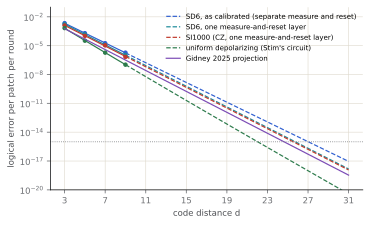

The distance that reaches 10⁻¹⁵ per patch-round runs from d = 23 to d = 29 across the four
models, and Gidney's d = 25 lies inside that range. SI1000 has the projection's slope here
(Λ = 11.6–12.3) but a
2.1× higher rate at d = 9; Stim's
circuit is below the projection. The calibration's circuit is the most pessimistic: it depolarizes idle
qubits in every layer and gives data qubits two idle layers a round, one for the ancillas' measurement and
one for their reset. Merging the two lowers the d = 9 rates 1.7–2.0× and raises Λ to
≈ 12. Every simulated algorithm run in this report rests on that circuit and leans pessimistic
accordingly. (The SD6 row fits the calibration's memories like the others, over d ≤ 9; with all its
memory lengths and d = 11 the calibrated model needs d = 29.)

**Recalibrated with one measure-and-reset layer.** Every calibration experiment was rerun on stabilizer-qec's circuits with
each reset layer folded into the measurement layer before it (ftalgo.calib.circuit_noise.merge_measure_reset_layers: every
noise channel kept except the reset layer's idle depolarizing; on memories it is the SD6 one-layer model above exactly).
Idling then has Λ = 11.6–12.5 at p = 0.1%, reaches 10⁻¹⁵ per patch-round at d = 27
(d = 27 at either 1σ edge), and one shot of Gidney's algorithm needs d = 27
at his budget; textbook RSA-2048 needs d = 33 (29 M physical qubits). Whole surgery experiments predicted from its parts are 0.87–1.14× the measured failure rate (median 1.02×), as for the original calibration. Section 3.7's
tables give both calibrations.

The simulated algorithm runs were repeated on the recalibrated machine as well (16 workloads with cultivated magic
states, plus the injected and 15-to-1 factories; data/results_mr/, run in parallel on GitHub Actions by tools/grid.py, which
splits long configurations into shot chunks and pools them). The distance at which a run first reaches 90% of its noiseless
success drops by one step for 9 of them and stays the same for 7; none needs more. Where the magic
states set the ceiling (injected states, H₂ with 15-to-1 distillation), the ceiling is unchanged within error.

| workload | p | noiseless | d for 90%, as calibrated | one measure-and-reset layer |
| :--- | ---: | ---: | ---: | ---: |
| Shor, textbook, N = 15 | 0.1% | 1.00 | 13 | 11 |
| Shor, textbook, N = 15 | 0.2% | 1.00 | 19 | 17 |
| Shor, textbook, N = 21 | 0.1% | 0.79 | 13 | 13 |
| Shor, textbook, N = 21 | 0.2% | 0.79 | 21 | 19 |
| Shor, textbook, N = 35 | 0.1% | 0.79 | 15 | 13 |
| Shor, textbook, N = 35 | 0.2% | 0.79 | 21 | 21 |
| Shor, textbook, N = 77 | 0.1% | 0.77 | 15 | 15 |
| Shor, textbook, N = 77 | 0.2% | 0.77 | 23 | 21 |
| Shor, textbook, N = 143 | 0.1% | 0.77 | 15 | 15 |
| Shor, textbook, N = 143 | 0.2% | 0.77 | 23 | 21 |
| Shor, windowed + MBU, N = 15 | 0.1% | 1.00 | 11 | 11 |
| Shor, windowed + MBU, N = 21 | 0.1% | 0.79 | 13 | 13 |
| Shor, windowed + MBU, N = 35 | 0.1% | 0.78 | 13 | 13 |
| H2 | 0.1% | 0.92 | 19 | 17 |
| HeH+ | 0.1% | 0.97 | 21 | 19 |
| LiH, CAS(2, 2) | 0.1% | 0.88 | 23 | 21 |

# Validation

- ftsim: dense = sparse on random circuits; 100 random circuits equal Qiskit's statevector to 10⁻¹⁰;
  noisy distributions equal Aer's exact density matrices (χ², plain and stratified); WebAssembly = native.
- Arithmetic, textbook and windowed, verified on every input by an independent bit-level simulator,
  including the measurement-based uncomputation and its feed-forward corrections; Shor's noiseless
  outcomes match the exact distribution; synthesized rotations verified as matrices; QPE matches its
  exact Trotterized distribution.
- Scaling: the Toffoli and qubit counts used at RSA-2048 equal the compiled circuits' for every simulated N;
  the estimator, given Gidney 2025's projection and budget, returns his d = 25.
- Chemistry: integrals, HF and FCI equal PySCF to 10⁻⁸ Ha; Szabo and Ostlund's H₂ reproduced; tapering
  preserves the spectrum; the LiH active-space Hamiltonian's ground energy equals PySCF's CASSCF(2, 2) to
  10⁻⁹ Ha (and CASCI on RHF orbitals to 10⁻¹¹ Ha).
- Calibration: Stim + PyMatching cross-check; reference-qubit experiment against plain memories;
  composition test. The sampling-and-decoding runner is checked against PyMatching's correlated decoder
  on the same samples (stabilizer-qec 2.x, like PyMatching, decodes with correlations only when asked at
  decode time as well; the calibration was run with 1.2).
- Noise models: SD6 applied layer by layer reproduces stabilizer-qec's circuit's error model exactly; the
  CZ rewrite is deterministic with graphlike distance d; SI1000's rates are Table 3's.

# Limitations

- Composition is accurate to about 10% (Section 3.2), measured only for d ≤ 7.
- Logical channels are measured to d = 11 (idling) and d = 9 (surgery) at p = 0.1%. Most algorithm
  results, and every RSA-2048 and FeMoco number, lie beyond that, along exponential fits; they are marked.
- Magic-state error rates and footprints, the H and S operation model and the timing constants are
  cited inputs, not measured here.
- Published algorithms enter only through their gate counts and run times; their layouts (Gidney 2025's
  yoked storage and parallel lookups, Lee et al.'s floor plan) are not modelled, so only distances are compared.
- The LiH problem is a 2-qubit active space; chemistry at scale is represented only by FeMoco's published counts.
- The machine is calibrated on stabilizer-qec's SD6 memory and surgery circuits, which measure and reset
  ancillas in separate layers (the pessimistic end of four circuit-level models, Section 3.9), and on the
  same circuits with one measure-and-reset layer; the figures and per-run tables use the first, and
  Section 3.9 compares the two. Biased noise and the codes tailored to it (XZZX) are not modelled.

# Reproduction

```
tools/build.sh                     # the engine (Rust → Python module)
python tools/calibrate.py          # circuit-level experiments (resumable)
python tools/fit_model.py          # data/calibration/model.json
python tools/compose_check.py; python tools/xcheck.py
python tools/noise_models.py; python tools/noise_models.py --summary
python tools/calibrate.py --mr; python tools/fit_model.py --mr; python tools/compose_check.py --mr
python tools/run_shor.py; python tools/run_shor_modern.py
python tools/run_qpe.py; python tools/run_lih.py
python tools/grid.py plan|run|merge   # the same runs on model_mr.json (or Actions → Algorithm grid)
python tools/scale.py; python tools/sensitivity.py
python tools/site_data.py; python tools/report.py
```
